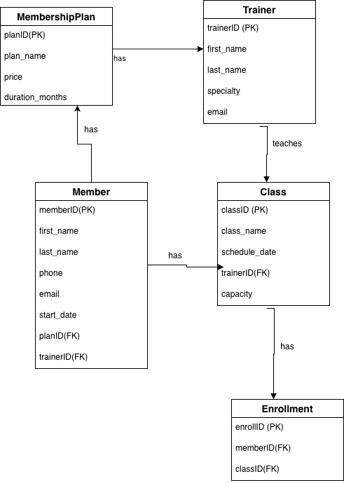

# Gym Management System (SQL Project)

By Niyog Uprety

This is a database project I did for my database class in college. The idea was to design a database a gym could actually use to keep track of its members, trainers, membership plans, classes and class enrollments.

This is college work, so it's a small project and not a full app. There's no front end, just the database design and the SQL.

## Project highlights

- **ER Diagram:** designed the full ER diagram in draw.io showing all 5 entities and how they relate ([see below](#er-diagram))
- **Relational Model:** turned the ER diagram into 5 tables with primary keys and foreign keys
- **Normalization (3NF):** checked every table so each column depends only on its primary key, no transitive dependencies
- **Use Cases:** wrote use cases for staff and admin tasks like adding members, enrolling members in classes and searching records
- **SQL Queries:** insert, update, delete, aggregate (COUNT, AVG, SUM), join and search queries for each use case
- **Testing:** tested the queries with expected vs actual output, all documented in the report

Everything above is explained in detail in the [full report (PDF)](report/Gym_Management_Report.pdf).

## What's in this repo

```
gym-management-sql/
├── README.md
├── report/
│   ├── Gym_Management_Report.pdf      the full project report
│   └── Gym_Management_Report.docx     same report in Word
├── images/
│   └── er_diagram.png                 ER diagram (made in draw.io)
└── sql/
    ├── 01_create_tables.sql           creates the database and 5 tables
    ├── 02_insert_data.sql             sample data, 10 rows per table
    ├── 03_use_case_queries.sql        insert, update, delete, aggregate, join and search queries
    └── original/
        └── gym_management_original.sql   my original script from MySQL Workbench
```

## The database

There are 5 tables:

| Table | What it stores |
|---|---|
| MembershipPlan | plan name, price, how many months it lasts |
| Trainer | trainer info, specialty, email, salary |
| Member | member info, start date, which plan they're on and which trainer they have |
| Class | class name, date, who teaches it, capacity |
| Enrollment | which member signed up for which class |

How they connect:

- A member has one plan and one trainer (Member.planID and Member.trainerID)
- A class is taught by one trainer (Class.trainerID)
- Enrollment connects members and classes, so one member can take many classes and one class can have many members

## ER Diagram



## Relational Model

```
MembershipPlan (planID, plan_name, price, duration_months)
Trainer        (trainerID, first_name, last_name, specialty, email, salary)
Member         (memberID, first_name, last_name, phone, email, start_date, planID, trainerID)
Class          (classID, class_name, schedule_date, trainerID, capacity)
Enrollment     (enrollID, memberID, classID)
```

The first column in each table is the primary key. planID, trainerID, memberID and classID are foreign keys wherever they show up in another table.

## How to view it

**If you just want to look at it**, you don't need to install anything:

1. Open `report/Gym_Management_Report.pdf` right here on GitHub. It has the ER diagram, relational model, normalization, use cases, all the queries and the test results.
2. Click on any file in the `sql/` folder to read the code.

**If you want to run it yourself**, you need MySQL installed (I used MySQL with MySQL Workbench).

Using MySQL Workbench:

1. Download or clone this repo
2. Open Workbench and connect to your local MySQL server
3. Go to File > Open SQL Script and open `sql/01_create_tables.sql`, then click the lightning bolt to run it
4. Do the same for `sql/02_insert_data.sql`
5. Then open `sql/03_use_case_queries.sql` and run it. You'll get a result tab for each SELECT query

Using the terminal:

```bash
git clone https://github.com/Niyog59/gym-management-sql.git
cd gym-management-sql
mysql -u root -p < sql/01_create_tables.sql
mysql -u root -p < sql/02_insert_data.sql
mysql -u root -p GymDB < sql/03_use_case_queries.sql
```

Heads up: `01_create_tables.sql` drops the database called `GymDB` if you already have one, so it starts fresh every time.

## About the original script

`sql/original/gym_management_original.sql` is the exact script I wrote in Workbench for the class. I ran it a few lines at a time while testing, not all at once, so if you run the whole file top to bottom some of the delete queries will fail because of foreign keys.

When I put this on GitHub I cleaned it up into the 3 files above so it runs from start to finish without errors:

- Split it into create tables, insert data and queries
- Added ON DELETE rules to the foreign keys, so deleting a member or class also removes their enrollments, and deleting a plan or trainer just sets that field to NULL instead of failing
- Added salary values to the trainer sample data so the average salary query actually returns a number
- Took out one line that was selecting from a table that doesn't exist

The queries themselves are the same ones from the report.

## What I used

- MySQL and MySQL Workbench
- draw.io for the ER diagram
- W3Schools SQL reference for checking syntax
